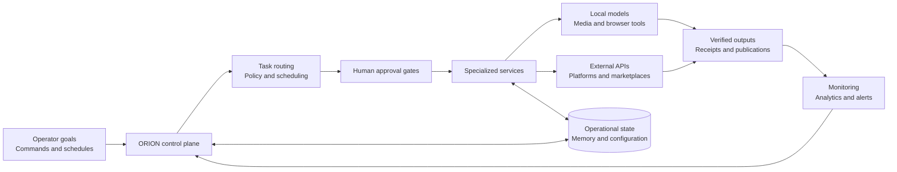

<!--
  Official ORION banner placeholder.
  When an approved banner is available, add it at docs/assets/orion-banner.png
  and place it above the project title.
-->

<div align="center">

# ORION

### Intelligent AI Orchestration & Autonomous Business Operations

ORION turns business objectives into controlled, observable workflows that combine
local AI, deterministic automation, human approval, and verified external actions.

</div>

## What is ORION?

ORION is a local-first orchestration platform for operating repeatable business workflows from one shared control plane. It routes work to specialized services, preserves operational context, applies human approval where an action has real-world impact, and records the result for monitoring and future decisions.

The project currently coordinates content production and multi-platform publishing, lead operations, developer workflows, and emerging digital-product capabilities. ORION is designed so a new channel, provider, or business domain can reuse the same scheduling, approval, persistence, and alerting foundations instead of creating a parallel system.

## Capability map

```mermaid
flowchart TB
    ORION[ORION<br/>Orchestration and control plane]

    ORION --> CONTENT[Content and Social<br/>Operational]
    ORION --> REVENUE[Revenue Operations<br/>Operational]
    ORION --> ENGINEERING[Engineering Automation<br/>Operational]
    ORION --> PRODUCTS[Digital Products<br/>In development]
    ORION --> PLATFORM[Platform Operations<br/>Operational]

    CONTENT --> VIDEO[Video generation and review]
    CONTENT --> PUBLISH[YouTube, TikTok, and Instagram publishing]
    CONTENT --> INSIGHTS[Publication analytics and engagement]

    REVENUE --> DISCOVERY[Bounded lead discovery]
    REVENUE --> QUALIFY[Extraction and qualification support]

    ENGINEERING --> ISSUES[Approved issue-to-PR workflow]
    ENGINEERING --> CI[Validation and CI handoff]

    PRODUCTS --> ASSETS[Digital asset research and generation]
    PRODUCTS --> WEBSITES[Website builder]
    PRODUCTS --> COMMERCE[E-commerce discovery integration]

    PLATFORM --> ROUTING[Task routing and policy]
    PLATFORM --> MEMORY[Operational state and memory]
    PLATFORM --> OBSERVE[Schedules, monitoring, and alerts]
```



| Domain | Status | Current scope |
| --- | --- | --- |
| Orchestration | **Operational** | Normalized tasks, policy-based routing, approval gates, schedules, durable state, and alerts |
| Content and social | **Operational** | Local video workflows, review, channel-owned schedules, publication to YouTube, TikTok, and Instagram, plus analytics and engagement actions |
| Lead operations | **Operational** | Bounded discovery, public-page extraction, local-model processing, and qualification support |
| Developer workflow | **Operational** | Approval-gated issue creation, isolated implementation, deterministic validation, draft pull requests, and merge approval |
| Digital assets | **In development** | Local research, generation, validation, review, packaging, and guarded marketplace delivery |
| Website builder | **In development** | Reusable templates, local editing and preview, design reuse, and server-side draft persistence |
| E-commerce integration | **In development** | Scheduled, bounded product discovery with human review in the separate commerce workspace |
| Advertising and wider marketplace automation | **Planned** | Future adapters that will reuse ORION's approval and verification boundaries |

Status labels describe the repository today; they are not promises that every workflow or third-party integration is production-complete.

## Technical architecture



The control plane owns intent, schedules, policy, and workflow state. Specialized services own domain behavior. Local tools handle suitable inference and media work without unnecessary hosted-model calls, while adapters isolate external platforms behind explicit authorization and verification boundaries.

## How ORION works

1. **Receive an objective.** An operator action or scheduled trigger enters the shared task and workflow model.
2. **Build a bounded plan.** ORION applies channel configuration, policy, retained context, and current state.
3. **Request approval when needed.** Publishing, account changes, marketplace actions, and other consequential steps stop at a human gate.
4. **Run the specialized workflow.** A domain service executes local work or calls an authorized provider adapter.
5. **Verify the outcome.** ORION checks hashes, provider state, CI, or public results before accepting completion.
6. **Persist and observe.** Durable receipts, analytics, failures, and alerts feed the next scheduling and operating cycle.

This creates one reusable pattern:

```text
objective -> plan -> approval -> execution -> verification -> feedback
```

## Design principles

- **Local first:** use local models and deterministic tools where they are capable and economical.
- **Human-controlled autonomy:** automate repeatable work while preserving explicit approval for consequential actions.
- **One source of scheduling truth:** channel configuration drives every enabled destination instead of duplicating platform schedules.
- **Provider isolation:** external services are adapters, not the owners of ORION's workflow state.
- **Fail closed:** uncertain authorization, stale approval, changed inputs, or unverifiable provider state stops mutation.
- **Idempotent recovery:** retries reconcile existing work before creating another external action.
- **Observable operations:** outcomes, failures, receipts, analytics, and alerts remain attributable to the workflow that produced them.

## Repository guide

| Area | Purpose |
| --- | --- |
| [`services/task-router`](services/task-router/) | Task normalization, routing, approval decisions, and write-back preparation |
| [`services/discord-bot`](services/discord-bot/) | Current operator interface, review surfaces, alerts, and summaries |
| [`services/product-video-agent`](services/product-video-agent/) | Video planning, rendering, review, publication, and analytics |
| [`services/leadgen-scraper`](services/leadgen-scraper/) | Bounded lead discovery and structured public-page extraction |
| [`services/developer-agent`](services/developer-agent/) | Approval-gated GitHub issue-to-pull-request automation |
| [`services/digital-asset-engine`](services/digital-asset-engine/) | Digital asset generation, validation, packaging, and release gates |
| [`services/digital-asset-research`](services/digital-asset-research/) | Evidence collection and product-opportunity research |
| [`apps/website-builder`](apps/website-builder/) | Local-first design library and website drafting interface |
| [`supabase/migrations`](supabase/migrations/) | Durable workflow-state schemas and access boundaries |

## Project status

ORION is under active development. Operational capabilities are exercised by the current owner-managed runtime; developing and planned areas remain subject to review, testing, provider policy, and explicit rollout decisions.

Configuration examples document required variable names, but credentials and owner-only runtime details do not belong in Git. Contributors should preserve approval, least-privilege, exact-input, and idempotency guarantees when extending a workflow.

## License and attribution

This repository is distributed under the terms in [LICENSE](LICENSE). Existing upstream and third-party copyright, license, and attribution notices must be retained.
